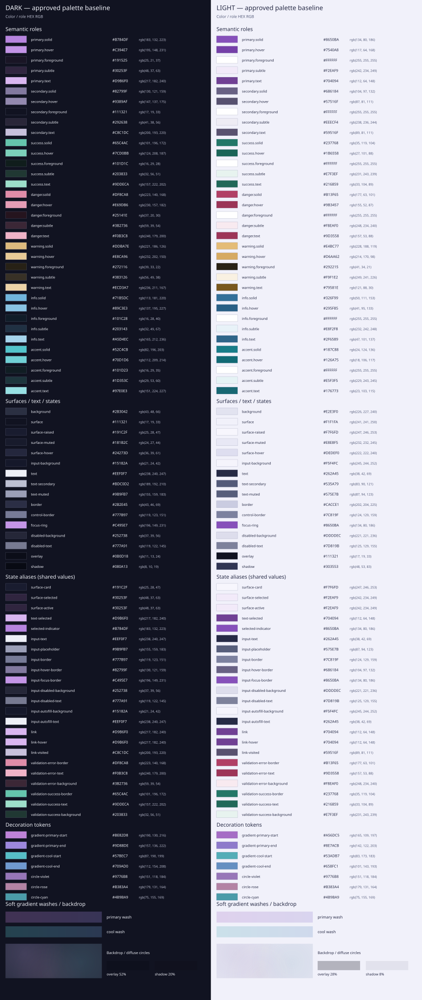

# Runa Color Palette

Status: approved by the user on 2026-10-17 as the starting palette for both themes. Dark mode retains its existing base; light mode is revised toward cool lavender/indigo surfaces. The temporary root view now uses these values; rendered visual acceptance remains pending.

Related: [visual direction](visual-direction.md), [REF-001](references/REF-001-dark-palette.webp).

## Direction and preview

Both themes share orchid/lavender, cyan and indigo identity. Light surfaces are deliberately tinted rather than pure white or neutral gray. Dark palette values from the preceding proposal are preserved. Colors are visual adaptations, not claimed pixel samples. Semantic status colors supplement the reference.

## Semantic roles

Bootstrap-like role names do not introduce Bootstrap. Solid/hover pair with foreground; subtle pairs with text. Dark pastel solids use dark foregrounds. The same foreground applies to solid and hover.

### Dark

| Role      | Solid                            | Hover                            | Foreground                    | Subtle background             | Text on subtle                   |
| --------- | -------------------------------- | -------------------------------- | ----------------------------- | ----------------------------- | -------------------------------- |
| primary   | `#B784DF` / `rgb(183, 132, 223)` | `#C394E7` / `rgb(195, 148, 231)` | `#191525` / `rgb(25, 21, 37)` | `#30253F` / `rgb(48, 37, 63)` | `#D9B6F0` / `rgb(217, 182, 240)` |
| secondary | `#82799F` / `rgb(130, 121, 159)` | `#9389AF` / `rgb(147, 137, 175)` | `#111321` / `rgb(17, 19, 33)` | `#292638` / `rgb(41, 38, 56)` | `#C8C1DC` / `rgb(200, 193, 220)` |
| success   | `#65C4AC` / `rgb(101, 196, 172)` | `#7CD0BB` / `rgb(124, 208, 187)` | `#101D1C` / `rgb(16, 29, 28)` | `#203833` / `rgb(32, 56, 51)` | `#9DDECA` / `rgb(157, 222, 202)` |
| danger    | `#DF8CA8` / `rgb(223, 140, 168)` | `#E69DB6` / `rgb(230, 157, 182)` | `#25141E` / `rgb(37, 20, 30)` | `#3B2736` / `rgb(59, 39, 54)` | `#F0B3C8` / `rgb(240, 179, 200)` |
| warning   | `#DDBA7E` / `rgb(221, 186, 126)` | `#E8CA96` / `rgb(232, 202, 150)` | `#272116` / `rgb(39, 33, 22)` | `#383126` / `rgb(56, 49, 38)` | `#ECD3A7` / `rgb(236, 211, 167)` |
| info      | `#71B5DC` / `rgb(113, 181, 220)` | `#89C3E3` / `rgb(137, 195, 227)` | `#101C28` / `rgb(16, 28, 40)` | `#203143` / `rgb(32, 49, 67)` | `#A5D4EC` / `rgb(165, 212, 236)` |
| accent    | `#52C4CB` / `rgb(82, 196, 203)`  | `#70D1D6` / `rgb(112, 209, 214)` | `#101D23` / `rgb(16, 29, 35)` | `#1D353C` / `rgb(29, 53, 60)` | `#97E0E3` / `rgb(151, 224, 227)` |

### Light

| Role      | Solid                            | Hover                           | Foreground                       | Subtle background                | Text on subtle                  |
| --------- | -------------------------------- | ------------------------------- | -------------------------------- | -------------------------------- | ------------------------------- |
| primary   | `#8650BA` / `rgb(134, 80, 186)`  | `#7540A8` / `rgb(117, 64, 168)` | `#FFFFFF` / `rgb(255, 255, 255)` | `#F2EAF9` / `rgb(242, 234, 249)` | `#704094` / `rgb(112, 64, 148)` |
| secondary | `#686184` / `rgb(104, 97, 132)`  | `#57516F` / `rgb(87, 81, 111)`  | `#FFFFFF` / `rgb(255, 255, 255)` | `#EEECF4` / `rgb(238, 236, 244)` | `#59516F` / `rgb(89, 81, 111)`  |
| success   | `#237768` / `rgb(35, 119, 104)`  | `#1B6558` / `rgb(27, 101, 88)`  | `#FFFFFF` / `rgb(255, 255, 255)` | `#E7F3EF` / `rgb(231, 243, 239)` | `#216859` / `rgb(33, 104, 89)`  |
| danger    | `#B13F65` / `rgb(177, 63, 101)`  | `#9B3457` / `rgb(155, 52, 87)`  | `#FFFFFF` / `rgb(255, 255, 255)` | `#F8EAF0` / `rgb(248, 234, 240)` | `#9D3558` / `rgb(157, 53, 88)`  |
| warning   | `#E4BC77` / `rgb(228, 188, 119)` | `#D6AA62` / `rgb(214, 170, 98)` | `#292215` / `rgb(41, 34, 21)`    | `#F9F1E2` / `rgb(249, 241, 226)` | `#79581E` / `rgb(121, 88, 30)`  |
| info      | `#326F99` / `rgb(50, 111, 153)`  | `#295F85` / `rgb(41, 95, 133)`  | `#FFFFFF` / `rgb(255, 255, 255)` | `#E8F2F8` / `rgb(232, 242, 248)` | `#2F6589` / `rgb(47, 101, 137)` |
| accent    | `#187C88` / `rgb(24, 124, 136)`  | `#126A75` / `rgb(18, 106, 117)` | `#FFFFFF` / `rgb(255, 255, 255)` | `#E5F3F5` / `rgb(229, 243, 245)` | `#176773` / `rgb(23, 103, 115)` |

## Surfaces, text and interaction

| Token               | Dark HEX / RGB                   | Light HEX / RGB                  |
| ------------------- | -------------------------------- | -------------------------------- |
| background          | `#2B3042` / `rgb(43, 48, 66)`    | `#E2E3F0` / `rgb(226, 227, 240)` |
| surface             | `#111321` / `rgb(17, 19, 33)`    | `#F1F1FA` / `rgb(241, 241, 250)` |
| surface-raised      | `#191C2F` / `rgb(25, 28, 47)`    | `#F7F6FD` / `rgb(247, 246, 253)` |
| surface-muted       | `#181B2C` / `rgb(24, 27, 44)`    | `#E8E8F5` / `rgb(232, 232, 245)` |
| surface-hover       | `#24273D` / `rgb(36, 39, 61)`    | `#DEDEF0` / `rgb(222, 222, 240)` |
| input-background    | `#15182A` / `rgb(21, 24, 42)`    | `#F5F4FC` / `rgb(245, 244, 252)` |
| text                | `#EEF0F7` / `rgb(238, 240, 247)` | `#262A45` / `rgb(38, 42, 69)`    |
| text-secondary      | `#BDC0D2` / `rgb(189, 192, 210)` | `#535A79` / `rgb(83, 90, 121)`   |
| text-muted          | `#9B9FB7` / `rgb(155, 159, 183)` | `#575E7B` / `rgb(87, 94, 123)`   |
| border              | `#2B2E45` / `rgb(43, 46, 69)`    | `#CACCE1` / `rgb(202, 204, 225)` |
| control-border      | `#777B97` / `rgb(119, 123, 151)` | `#7C819F` / `rgb(124, 129, 159)` |
| focus-ring          | `#C495E7` / `rgb(196, 149, 231)` | `#8650BA` / `rgb(134, 80, 186)`  |
| disabled-background | `#252738` / `rgb(37, 39, 56)`    | `#DDDDEC` / `rgb(221, 221, 236)` |
| disabled-text       | `#777A91` / `rgb(119, 122, 145)` | `#7D819B` / `rgb(125, 129, 155)` |
| overlay             | `#0B0D18` / `rgb(11, 13, 24)`    | `#111321` / `rgb(17, 19, 33)`    |
| shadow              | `#080A13` / `rgb(8, 10, 19)`     | `#303553` / `rgb(48, 53, 83)`    |

`border` is a decorative separator; `control-border` identifies interactive fields. Sidebar/topbar use the same indigo/lavender surface family. Input autofill preserves the ordinary surface and text while retaining browser/password-manager support. Disabled controls use the dedicated background/text pair.

## Shared aliases and practical coverage

These names explicitly cover common business UI needs without adding new colors. Preview swatches resolve the aliases to actual HEX values.

| Token                           | Reuses                |
| ------------------------------- | --------------------- |
| `surface-card`                  | `surface-raised`      |
| `surface-selected`              | `primary.subtle`      |
| `surface-active`                | `primary.subtle`      |
| `text-selected`                 | `primary.text`        |
| `selected-indicator`            | `primary.solid`       |
| `input-text`                    | `text`                |
| `input-placeholder`             | `text-muted`          |
| `input-border`                  | `control-border`      |
| `input-hover-border`            | `secondary.solid`     |
| `input-focus-border`            | `focus-ring`          |
| `input-disabled-background`     | `disabled-background` |
| `input-disabled-text`           | `disabled-text`       |
| `input-autofill-background`     | `input-background`    |
| `input-autofill-text`           | `text`                |
| `link`                          | `primary.text`        |
| `link-hover`                    | `primary.text`        |
| `link-visited`                  | `secondary.text`      |
| `validation-error-border`       | `danger.solid`        |
| `validation-error-text`         | `danger.text`         |
| `validation-error-background`   | `danger.subtle`       |
| `validation-success-border`     | `success.solid`       |
| `validation-success-text`       | `success.text`        |
| `validation-success-background` | `success.subtle`      |

Selected/active navigation combines a subtle surface, selected text and a solid indicator. Hover uses surface-hover or the semantic hover token. Active/pressed buttons may reuse hover with an inset/position cue; do not rely solely on color. Links remain recognizable through underlining; hover can reuse the same accessible color with stronger underline treatment. Validation uses message/icon plus color, with the ordinary field background by default; tinted validation backgrounds are optional. Error borders do not replace keyboard focus. Charts may reuse primary/accent/info/secondary; distinguish series with labels and line/marker patterns. No separate chart or status palette is needed yet.

## Gradients and decoration

| Token                  | Dark HEX / RGB                   | Light HEX / RGB                  |
| ---------------------- | -------------------------------- | -------------------------------- |
| gradient-primary-start | `#BE82D8` / `rgb(190, 130, 216)` | `#A56DC5` / `rgb(165, 109, 197)` |
| gradient-primary-end   | `#9D88DE` / `rgb(157, 136, 222)` | `#8E7ACB` / `rgb(142, 122, 203)` |
| gradient-cool-start    | `#57BEC7` / `rgb(87, 190, 199)`  | `#53ADB7` / `rgb(83, 173, 183)`  |
| gradient-cool-end      | `#709AD0` / `rgb(112, 154, 208)` | `#658FC1` / `rgb(101, 143, 193)` |
| circle-violet          | `#9776B8` / `rgb(151, 118, 184)` | `#9776B8` / `rgb(151, 118, 184)` |
| circle-rose            | `#B383A4` / `rgb(179, 131, 164)` | `#B383A4` / `rgb(179, 131, 164)` |
| circle-cyan            | `#4B9BA9` / `rgb(75, 155, 169)`  | `#4B9BA9` / `rgb(75, 155, 169)`  |

Keep orchid-to-lavender and cyan-to-blue transitions. Render them as soft decorative washes, blending the endpoint colors over the theme surface at 24% opacity in light and 28% in dark, instead of full-strength neon fills. The preview shows these composited gradients. This changes gradient treatment, not the existing dark endpoint colors. Gradient foregrounds require their own contrast verification.

Large cropped page circles use the background as their base: violet/rose/cyan opacities are 10%/8%/8% in light and 20%/14%/16% in dark. Use broad radial fades and soft edges rather than sharp color transitions. Preview includes a suggested backdrop composition, not final geometry.

Overlay source opacity: light 28%, dark 52%. Shadow source opacity: light 8%, dark 20%. Swatches show their resolved appearance over surface; actual overlays blend with content underneath. Shadows remain delicate.

## Approval, verification and scope

The palette covers backgrounds, cards/elevation, hover/selection, actions, text, borders, fields, focus, disabled states, links, semantic feedback, validation, overlay/shadow and decorative gradients. Aliases intentionally reuse values. Component-specific additions require an actual uncovered need.

The user accepted the palette and its SVG preview as the design baseline, with practical validation and proportionate adjustments during application development. This approval covers colors, not the complete visual specification or component redesign.

During implementation, validate the rendered components, both themes and autofill. Check text pairs at 4.5:1 and necessary control boundaries at 3:1. Disabled controls are exempt from normal contrast requirements but should remain identifiable. Decorative borders intentionally have lower contrast. The root preview implements this palette; future auth/app templates remain outside this implementation.
