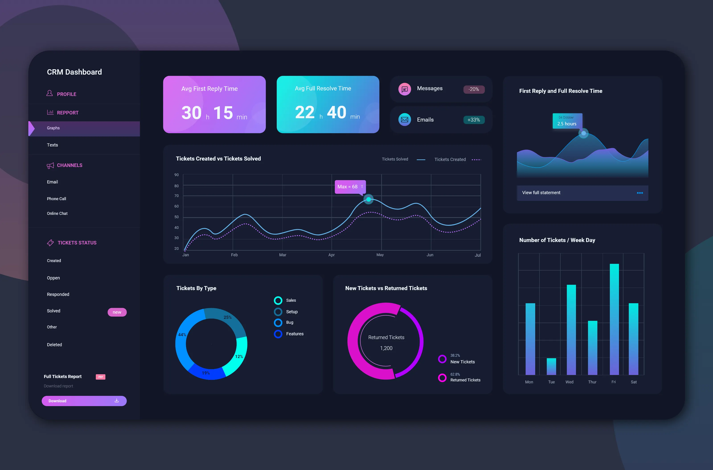
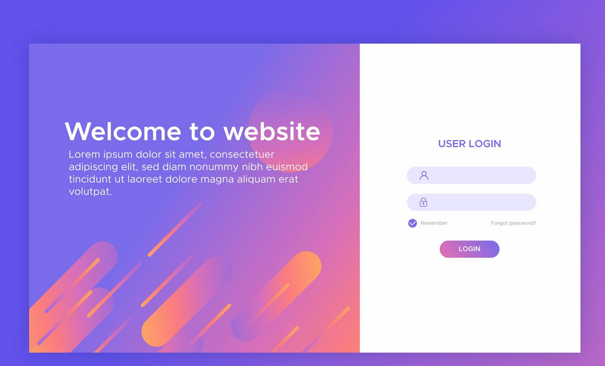

# Runa Visual Direction

Status: general visual direction and temporary root-preview implementation approved. The root view is implemented and awaits explicit user visual acceptance under roadmap point 16. Future auth/app template details remain open.

Roadmap: [RM-2026-001, point 16](../roadmaps/active/RM-2026-001-development-environment.md).

## Reference interpretation

Reference images contribute only the features explicitly selected by the user. An image is not approval to reproduce its entire interface. Unmentioned layout, typography, components, spacing and decoration remain undecided. Explicit rejections are recorded separately; the user does not need to enumerate everything they dislike.

Combine selected features from subsequent references into a coherent interface. Do not treat any single reference as the complete design. Record further decisions here before implementation and obtain explicit approval of the complete specification under roadmap point 16.

## REF-001 — Dark palette and circular background

Received: 2026-10-17, user-provided image in the design discussion.

Image identification: a dark CRM dashboard with purple/cyan summary panels and charts, surrounded by a gray background with large cropped circular shapes.

Asset: [REF-001-dark-palette.webp](references/REF-001-dark-palette.webp), supplied by the user. Identify references by their stable ID and descriptive basename; extensions may vary. Do not substitute a generated reconstruction for the reference.

Original author/source URL: not supplied.

### Selected direction

- Use the image's dark-mode color direction: dark graphite/navy surfaces with purple, cool blue and turquoise accents. These are qualitative observations, not approved exact color tokens.
- Make gradients more restrained than in the reference, appropriate for a business application. Gradients are welcome when subtle; the strong saturation and transitions shown are not the target intensity.
- Use a gray background with large circular shapes and gentle gradients, including shapes cropped by the viewport edges. Implement this decorative background in CSS rather than as a raster background image.

### Explicit rejection

- The strongly rounded corners shown in this image are disliked. The replacement radius scale remains undecided.

### Not selected from this reference

The dashboard layout, cards, charts, typography and other component styling are not adopted. The depicted CRM functionality does not expand Runa's roadmap scope.

## REF-002 — Authentication layout

Received: 2026-10-17, user-provided image in the design discussion.

Asset: [REF-002-auth-layout.png](references/REF-002-auth-layout.png). Reference identity follows the ID and basename, not a required extension.

Original author/source URL: not supplied.

### Selected direction

- Apply this reference only to authentication view layout: a single panel with content and a decorative section. The later approved reusable layout places content/forms on the left and the illustration on the right, matching the refined root preview.
- Behind the entire authentication panel, use the gray circular CSS background selected from REF-001, adapted to the active theme.
- Inside the decorative section, use an attractive background with a CSS-created decorative illustration. Abstract shapes similar to this reference are acceptable; the exact composition remains open.
- Integrate the illustration with Runa's agreed palette and restrained gradients.

### Not selected from this reference

Do not adopt its palette, typography, field styling, button styling or copy. It supplies no layout direction for other application views. Exact panel proportions and mobile treatment remain undecided.

This records visual intent for login and registration views. It does not authorize implementing authentication behavior or adding backend/business scope to this environment roadmap; implementation scope must be agreed before work resumes.

## REF-003 — Shared application and admin shell

Received: 2026-10-17, user-provided image in the design discussion showing an SB Admin 2 dashboard.

Asset status: visible in the conversation; file not yet present in the reference directory. Use basename `REF-003-app-layout` with the supplied file's actual extension, then add its link and preview here.

Original author/source URL: not supplied.

### Shared layout and navigation semantics

Use the same shell design and navigation behavior for the user application and admin panel. Existing language conventions remain: Polish by default for the user application, English for admin.

Use the background selected from REF-001 for both shells: a gray base with large circular shapes and restrained gradients, rendered in CSS and adapted to the active light/dark theme. REF-003 does not replace that background direction.

- The sidebar contains module links. Every sidebar link has a Tabler icon.
- At the top of the sidebar, display the Runa logo and application name. Use the user-supplied Runa mark through the shared RunaLogo component.
- Support expanded and collapsed sidebar states with an explicit toggle. Expanded: show link icons and labels, plus logo and application name. Collapsed: retain link icons and the logo, hiding link labels and the application name.
- Collapsed links reveal their labels through a reusable, application-styled tooltip component. Do not rely on native browser `title` tooltips. Tooltips must also work on keyboard focus, and icon-only controls retain accessible names.
- The top navigation displays the current module's additional links on the left, when that module has any. The sidebar selects the module; top links navigate within it.
- At the right of the top navigation, show a circular user-initials control that opens a dropdown. Notifications, profile navigation and logout are future dropdown content; their functionality is not implemented merely by recording this design.
- Other top-bar content from the reference, including search and separate notification controls, is not selected.

### Page structure

Always place breadcrumbs at the top of the page content. Below them, preserve this order while omitting optional sections that the page does not have:

1. Page statistics, when applicable.
2. Filters, when applicable.
3. The page's main content, such as a table, charts or forms.

Do not copy dashboard content, cards, charts or their appearance from this reference. Its palette and typography are not selected; apply the separately agreed Runa visual direction.

### Footer

Include a footer at the bottom of the shell with copyright information, a link to the user's GitHub and the application version. Additional footer content may be agreed later. Current shared footer uses “© {current year} Łukasz Przybylski”, the Runa repository at https://github.com/lprzybylskidev-prog/runa and the version read from root VERSION at build time.

### Remaining scope

Record a reusable shell for both application contexts; this does not authorize implementing business modules, authentication, permissions, notifications or profile functionality. Mobile navigation, top-link overflow and sidebar state persistence remain to be agreed. The circular initials control is specifically selected despite the rejection of strongly rounded general component corners in REF-001.

## Icons

User decision (2026-10-17): use Tabler Icons as the project's icon family. This selection is approved and implemented as a small local SVG subset in the root preview. Do not infer adoption of other Tabler UI components or styling. Source revisions, preserved licenses and hashes are recorded in [asset provenance](assets.md); no icon package dependency was added.

## Theme development

Develop the dark visual direction first, then derive a coherent light theme. Both themes remain required. REF-001 itself supplies no light palette. The derived light palette and matching dark palette were accepted by the user on 2026-10-17; see the color palette document. Validate their actual rendering during implementation.

## Typography

User decision (2026-10-17): use IBM Plex Mono as the interface typeface for Runa, across application/admin and authentication views, in both themes. This choice applies to the UI, not only code or numeric content.

Exact weights, sizes, line heights and font delivery remain to be established during approved implementation. Verify Polish characters, readable dense tables and forms, responsive text wrapping and loading/fallback behavior. The root preview now serves local Regular and SemiBold WOFF2 assets; source revision, OFL license and hashes are recorded in [asset provenance](assets.md), without a font package dependency.

## Component appearance

Approved starting semantic color values for both themes: [color palette](color-palette.md), accepted by the user on 2026-10-17 together with the SVG preview. Practical adjustments may follow rendered validation during application development.

Palette review direction: retain the current dark palette as the baseline. Give light mode more cool lavender/blue-indigo character, with tinted surfaces instead of pure white and neutral gray. Both themes retain violet and cyan accents and soft, diffuse, restrained gradients. The palette explicitly maps common business UI states through shared tokens and aliases; the revised palette is approved as the baseline, while the root preview awaits user visual acceptance.

User direction (2026-10-17): Runa is a business system. Readability is essential, while the interface should remain visually engaging. Balance restrained decoration with visible color accents; avoid both a bland, colorless interface and loud, heavily saturated surfaces.

- Retain subtle gradients as part of the visual language. Reduce their strength relative to REF-001 rather than removing them altogether. Keep text and data legible over decorated surfaces.
- Use minimal corner rounding for ordinary components. Avoid both strongly rounded shapes and a universally square treatment. Exact radius values remain to be established consistently across components; the selected circular user-initials control remains intentional.
- Retain delicate shadows where they help distinguish surfaces or elevation. Avoid heavy shadows; exact values must work in both themes.
- Use color confidently but in moderation throughout the interface: controls, navigation, surfaces, borders, icons and status feedback. Color should communicate hierarchy or state and add character without overwhelming content. Avoid making the interface uniformly neutral out of excessive restraint.

### General use of color accents

The user's alert example illustrates a general principle, not an alert-only rule or a mandatory component template: a subdued surface can gain character and meaning through a carefully placed color accent, such as a colored bottom border, instead of an intense full-surface fill. Apply this balance across the interface, choosing the accent placement appropriate to each component. Do not require a bottom border on every alert or component.

Keep text readable and communicate status with text and, where useful, a Tabler icon as well as color. Exact accent treatments, border thickness, spacing, radii and semantic tokens remain part of the complete visual specification.

## Forms, validation and browser autofill

User decision (2026-10-17): application forms do not use built-in HTML/browser validation UI. Use `novalidate` and application-controlled validation with consistently styled field errors and messages. Frontend checks handle known invalid input immediately; backend validation remains the integrity and security authority. Preserve semantic input types, labels and accessible error associations.

Style browser autofill states, including saved credentials filled by the browser or a password manager, to match Runa's input surfaces, text, borders and focus treatment in both themes. Avoid browser-default autofill highlights that clash with the design. Preserve autocomplete and password-manager functionality; do not disable them to work around styling. Verify actual autofilled fields during rendered acceptance where browser support permits.

Related baseline: [Frontend architecture — forms and validation](../architecture/frontend.md).

## Responsive design approach

User direction (2026-10-17): separate phone and tablet references are not expected. Derive those layouts from the agreed desktop/web visual language, preserving palette, typography, component consistency and navigation semantics while adapting arrangement and interaction to available space and touch input.

During the approved implementation, the agent should design appropriate phone and tablet adaptations without waiting for additional reference images. Validate rendered layouts, readable content, touch controls and access to both module and within-module navigation. Exact responsive arrangements remain design work; do not simply shrink the desktop layout or rely on hover for essential information on touch devices.

## Density and component sizing

User accepted (2026-10-17): use a moderately compact interface, with comfortable forms and tables without excessive whitespace. Account for IBM Plex Mono's width when checking labels, dense data and responsive wrapping.

Use approximately 4px corner radii as the starting scale for ordinary components, consistent standard input/button heights and a smaller variant for table controls. Exact dimensions may be chosen during approved design implementation and reviewed in rendered UI. Preserve the explicitly selected circular user-initials control.

## Navigation behavior

User accepted (2026-10-17): remember the sidebar's expanded/collapsed preference. On phones, present navigation as an opened-on-demand panel and keep module links accessible without requiring precise taps on small icons. Derive tablet behavior from available space. Storage failure must not prevent navigation.

## Feedback and application states

User accepted (2026-10-17): show field errors beside their fields and operation-wide errors near the form. Use brief notifications for confirmations. Establish consistent loading, empty-results and retry-after-error states.

Flash messages appear at the top right, offer an explicit close control and disappear automatically after a timeout. Exact timeout and stacking behavior remain to be determined. Adapt placement to narrow screens without covering essential controls. Make notifications accessible, allow enough reading time and pause dismissal while hovered or keyboard-focused; important recoverable errors must remain available in their relevant page/form context.

## Implementation scope discussion

Agreed first implementation scope (2026-10-17): as the last stage of roadmap point 16, redesign the existing root `/` dashboard to demonstrate the agreed general visual language. The root remains a temporary welcome view rather than functional authentication or an app/admin shell. Following subsequent user review, its split panel is now extracted as the reusable AuthLayout; do not apply REF-003's app/admin navigation template. Apply the approved palette, IBM Plex Mono, Tabler Icons, restrained CSS background/gradients, component styling, transitions, responsive and accessible behavior where relevant to the existing page.

The dashboard is temporary and expected to be removed soon. Keep the work proportionate, preserve its existing useful behavior and avoid adding business functionality or app/admin layouts. The user subsequently authorized extracting the current view as the reusable auth layout, without implementing authentication. Review the rendered result with the user and refine the visual decisions if needed. Technical verification alone does not complete point 16: explicit user acceptance of the generated view is required before closure.

## Motion and transitions

User direction (2026-10-17): consider motion from the start of component design rather than adding it as a final polish pass. Runa is a business application: transitions should be subtle, purposeful and unobtrusive.

Visual state changes should generally transition smoothly rather than jump abruptly. For example, hover changes to background, text, border or shadow should feel continuous. Apply the same principle where appropriate to focus/selected states, dropdowns and sidebar changes, without animating every element or adding decorative motion by default. Feedback must remain immediate; transitions must not delay actions or obscure state.

Respect `prefers-reduced-motion`, reducing or removing nonessential movement. Transition only the properties that need it rather than applying a blanket transition to everything. Exact durations, easing and component-specific transitions remain to be established and checked in rendered UI; no numerical timing specification has been approved yet.

## Open decisions

- Further references and the specific features selected from each.
- Rendered validation of the approved palette, including gradient intensity.
- Layout and the placement/visibility of decorative background around application surfaces.
- Typography scale/weights (IBM Plex Mono selected), exact spacing/sizing and component appearance; approximately 4px ordinary radii and moderate density are accepted starting points.
- Motion timings, easing and component-specific transition behavior.
- Responsive treatment of the decoration and shell.
- Authentication panel proportions, small-screen arrangement and exact CSS illustration.
- Detailed tablet adaptation and top-navigation overflow; phone navigation panel and sidebar preference persistence are accepted.
- Flash-message timeout, stacking and detailed presentation.
- User review of the implemented shared footer.
- Practical light-theme validation against the approved palette.
- Complete visual-specification approval and concrete implementation/acceptance tasks.

## Interface copy and preference controls

User correction: use concise, professional, factual UI copy. Avoid promotional slogans, generic motivational wording and repeated workspace/growth taglines. Omit unnecessary text instead of replacing it with another slogan.

Language and theme preferences use exactly two compact buttons, not selects or expanded option groups. Language cycles PL/EN; theme cycles system/light/dark and updates its icon. Use short application-styled tooltips: “Zmień język” / “Zmień motyw” (English: “Change language” / “Change theme”). Accessible names may additionally describe current/next choices; preserve keyboard operation and preference persistence.

Root preview refinement: remove the visible application-connection/status block and its request from the root view. Expand the existing CSS illustration to occupy the right column. Backend health behavior remains available independently.

Root artwork placement: the decorative illustration fills the entire right half of the outer panel, flush with its top, right and bottom edges, following the split-panel composition clarified using REF-002. Padding belongs only to the text section; the illustration is not an inset card. On narrow screens it becomes a full-width lower section. This specific root layout refinement does not add auth behavior.

## Reusable auth layout

User decision (2026-10-17): preserve the current split-panel view as `resources/js/layouts/AuthLayout.vue`, reused immediately by the temporary root page and later by auth pages. It owns the backdrop, brand, compact preference controls, skip/main structure, illustration and footer. Its default slot supplies page/form content on the left and exposes the current translator as `t`; the CSS illustration fills the right half. This orientation supersedes the initial REF-002 left-decoration/right-form direction. Root removal must not remove the shared layout or its assets. Authentication behavior and actual forms remain outside this change.

## Component reuse

User requirement: repeated UI elements, including buttons and their visual states, must be reusable components rather than one-off view implementations. AppButton owns shared button styling/states, AppTooltip owns tooltip styling/behavior, AppIcon owns icon rendering and AuthLayout owns the split-page structure. Reuse and extend these instead of rebuilding controls for each page.

## Preference change screen

User decision: activating language or theme controls first covers the entire viewport with the shared AppLoadingOverlay and centered circular loading indicator. Apply the change only after the cover enters, then hold the opaque cover for an additional 500ms after rendering before revealing the updated view, as requested during visual review. Block underlying interaction and repeated changes until completion, restore focus to the initiating button, and respect reduced-motion settings. This is a local visual transition, not a page reload or network request.

## Background depth refinement

Current preview removes all decorative rings/arcs at the user's request. Retain the technical grid. Following user review, add large, more pronounced and diffuse corner gradients in the removed rings’ colors: violet/lavender/rose at the upper left and cyan/blue at the lower right. Use broad fades without ring contours and preserve a quieter center. No full circles or cropped arcs remain in the page backdrop. The main card stays opaque and visually dominant; its internal orbital illustration is unchanged. Use three large, visibly distinct constellation structures spanning the backdrop, cropped by viewport edges and passing behind the opaque card, rather than small standalone decorations: fine connecting lines, small points and low-opacity glow. Use different point counts and branching/connectivity, not repeated five-point chains. Keep them static and subordinate to the card; show only two quieter details on narrow screens. The reference selects this motif, not a starfield or bright lens flares. This version is pending user visual review.

## Project logo

The user supplied `resources/images/runa-logo.png`. Its transparent alpha enables recoloring using a CSS mask; RunaLogo preserves the original and compensates for its transparent padding. The auth-layout header and central illustration now use this mark, inheriting the theme’s primary text color. No SVG tracing or generated reinterpretation is performed.

The logo illustration’s orbital outlines also carry small static glowing points, matching the constellation motif. Share their appearance across all orbit outlines, use violet/cyan theme colors and keep glow restrained in both themes.

## Light-theme visibility refinement

User accepts the current dark direction; keep dark values unchanged. Light mode uses a more legible technical grid (9% versus dark 4.5%) and stronger constellation line opacity (48% versus dark 20%, before group opacity). The illustration shares the main surface base in light mode with slightly gentler violet/cyan washes and a much quieter divider, reducing the split-card appearance. These are contextual decoration tokens, not a replacement semantic palette.
